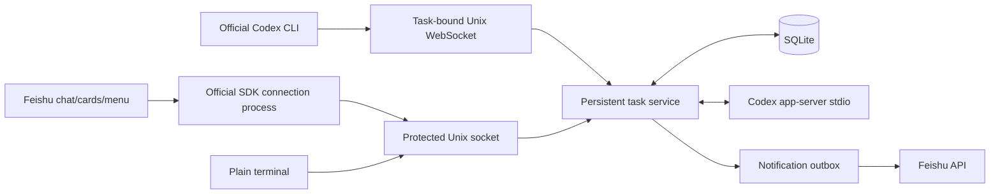

# Feishu Bot + Codex Task Service

[简体中文](README.md) | [English](README.en.md)

A persistent development task service running under an Ubuntu user account. Create and continue tasks from a Feishu private chat, then take control of the **same background task** with `feishu-codex attach` on your computer. Stack: Python 3.12, official `lark-oapi` 1.7.3, `websockets` 15.0.1, asyncio, SQLite, and protected Unix sockets. The app-server integration uses schemas exported by the installed **Codex CLI 0.160.0**.

**Deployment snapshot, 2026-10-11:** the local `zhi` systemd user service is installed; app-server is ready; the Feishu long connection is connected; one user is allowlisted; no pending or failed notifications were reported. Direct chat, guided task creation, ordinary question handling, Card JSON 2.0 formatting, approvals, and official Codex CLI takeover are implemented. Historical records include real messages, card callbacks, and bot menu events. This describes this installation, not a fresh checkout. See section 8 for tested behavior and remaining phone acceptance checks.

This English guide covers the same deployment and features as the [Chinese guide](README.md). **The application's buttons and messages are still primarily Chinese.** Bilingual documentation does not imply a localized English UI. This project targets the default Feishu China API endpoints; switching to international Lark endpoints is not configured or verified.

## 1. Installation and configuration

| Component | Local/default location |
| --- | --- |
| Source | `/home/zhi/ws/feishu-codex` on this machine |
| Private configuration | `~/.config/feishu-codex/config.toml`, mode `600` |
| Database, logs, and control socket | `~/.local/share/feishu-codex/`, directory mode `700` |
| Projects created by the wizard | `~/ws/<name>` |
| Additional allowed root for older tasks | `~/remote-ws` |
| User service | `~/.config/systemd/user/feishu-codex.service` |
| Installed command | `~/.local/bin/feishu-codex` |

Verified platform: Ubuntu 24.04, Python 3.12, Codex CLI 0.160.0. On another machine, put the project in your own directory, for example `~/ws/feishu-codex`; the `/home/zhi` paths are local examples, not a requirement to create a user named `zhi`.

Install prerequisites if needed, then check the existing Codex installation:

```bash
sudo apt update
sudo apt install python3 python3-venv git
command -v codex
codex --version
```

Codex must already work for this Linux user with your organization's model service and credentials. The project does not install or replace Codex authentication. Native terminal takeover depends on the verified CLI's `resume --remote unix://...` support; validate other CLI versions before upgrading.

From the project directory:

```bash
bash scripts/install.sh
export PATH="$HOME/.local/bin:$PATH"
systemctl --user enable --now feishu-codex
feishu-codex doctor
```

The installer creates `.venv`, installs dependencies, creates the command symlink, and renders the user service. It preserves existing private configuration and does not change `~/.codex/config.toml`, authentication, or the model provider. It only substitutes the detected Codex executable path when creating a new configuration from [config.example.toml](config.example.toml). The service starts when you run `enable --now`, not merely when installation finishes. No remote Git push is performed.

If zsh reports `command not found`, add `export PATH="$HOME/.local/bin:$PATH"` to `~/.zshrc` and run it in the current shell. zsh normally does not read Ubuntu's `~/.profile`. Alternatively use `~/.local/bin/feishu-codex tasks`; activating the virtual environment is unnecessary.

Edit the **private** configuration, retaining existing fields:

```bash
nano ~/.config/feishu-codex/config.toml
chmod 600 ~/.config/feishu-codex/config.toml
```

| Field | Meaning/default |
| --- | --- |
| `work_roots` | Allowed roots; the wizard uses the first, `~/ws`; `~/remote-ws` supports older tasks |
| `data_dir`, `socket_path` | Runtime data and local control socket; check both when customizing |
| `codex_command` | Exactly `[executable, "app-server", "--stdio"]`; extra bypass flags are rejected |
| `approval_policy`, `sandbox` | Default `on-request` / `workspace-write`; also supports `untrusted` / `read-only` |
| `rpc_timeout`, `turn_timeout`, `approval_timeout` | Seconds: 45 / 7200 / 1800 |
| `interrupt_timeout`, `lease_timeout`, `progress_interval` | Seconds: 15 / 30 / 30 |
| `notification_retries` | At most 4 delivery attempts |
| `log_max_bytes`, `log_backups` | 2 MiB per log, 3 rotated backups |
| `[feishu].app_id` | Application identifier from the developer console; not an API secret |
| `[feishu].app_secret` | Secret; keep outside source control and task messages |
| `[feishu].allowed_users` | Application-specific user `open_id` values; empty denies remote task operations |

You can choose another configuration with `feishu-codex --config /absolute/path/config.toml ...` or `FEISHU_CODEX_CONFIG`. A custom socket parent must belong to the current user and have mode `700`. To render the service for another configuration:

```bash
FEISHU_CODEX_CONFIG=/your/private/path/config.toml .venv/bin/python scripts/render-service.py
systemctl --user daemon-reload
systemctl --user restart feishu-codex
```

With Feishu credentials blank, the local daemon, CLI, and simulated tests still work. `doctor` explicitly reports that Feishu is not configured. Credentials alone do not authorize users or enable event subscriptions.

## 2. Create and authorize a Feishu application from scratch

Skip steps already completed for your existing application. No public IP, domain, webhook, or inbound port is required. The machine needs outbound HTTPS/WebSocket access to Feishu and access to your existing model service. An enterprise administrator may need to approve permissions and publication.

### 2.0 Create an enterprise custom app and add a bot

1. Sign in to the [Feishu developer console](https://open.feishu.cn/app) with an account in the intended organization. Ask its administrator for development access if creation is unavailable.
2. Choose **Create enterprise custom app / 创建企业自建应用**. Enter a name, description, icon, and any other required fields. Use an enterprise app bot, not a group webhook custom bot.
3. Open **Add app capabilities / 添加应用能力**, find **Bot / 机器人**, and add or enable it. Save its name and description. A web app, homepage, and OAuth redirect URL are not needed.
4. Open **Credentials & Basic Information / 凭证与基础信息 → App Credentials / 应用凭证** and obtain App ID and App Secret. Store them only in the private configuration described below.
5. Complete permissions, the local connection, events and callbacks, publication, and the local allowlist in sections 2.1–2.4. You can configure the bottom menu from section 3.2 before the first publication.

The official [application creation tutorial](https://open.feishu.cn/document/quick-start-of-personnel-and-attendance-management-system/step-1-create-and-configure-an-application) shows creation and bot capability controls. Only the permissions listed below are required here; do not copy the tutorial's attendance, approval, web, or directory permissions. If using a test version, its credentials, members, and client tenant must match. Recheck them when switching to production.

### 2.1 Credentials and minimum permissions

Edit the `[feishu]` section in the private configuration. These example values are deliberately blank:

```toml
[feishu]
app_id = ""
app_secret = ""
allowed_users = []
```

Fill the first two fields locally, set file mode `600`, and start or restart the user service. Keep `allowed_users` empty during initial identity discovery. The connection and `/whoami` discovery work with an empty allowlist; remote task operations do not. Preserve valid existing credentials rather than copying them into chat or documentation.

Under **Permissions / 权限管理 → Enable permissions / 开通权限**, request these application-identity permissions:

| Permission | Purpose |
| --- | --- |
| `im:message.p2p_msg:readonly` | Receive users' private messages to the bot |
| `im:message:send_as_bot` | Send messages and cards as the app, and update its sent cards |

The initial release does not require group messages, full directory access, cloud documents, administrator permissions, CardKit streaming permissions, or access to employee `user_id`. Identity checks use `open_id`. The official [receive event](https://open.feishu.cn/document/server-docs/im-v1/message/events/receive), [send API](https://open.feishu.cn/document/server-docs/im-v1/message/create), and [card update API](https://open.feishu.cn/document/uAjLw4CM/ukTMukTMukTM/reference/im-v1/message/patch) are the authority for permission requirements. The send-as-bot permission is one of the accepted permissions for updating cards; a separate broad messaging permission is not required by this implementation.

### 2.2 Long connection, message events, and new card callbacks

Make sure the local backend is running with valid app credentials first:

```bash
systemctl --user start feishu-codex
feishu-codex doctor
```

In **Events & Callbacks / 事件与回调**:

1. Under event configuration, select **Use long connection to receive events / 使用长连接接收事件** and save. Keep the backend running so the platform can detect the connection.
2. Add **Receive message v2.0 / 接收消息 v2.0**, event `im.message.receive_v1`.
3. For the bottom menu, also add **Bot custom menu event / 机器人自定义菜单事件**, `application.bot.menu_v6`.
4. Under the separate **callback configuration**, select **Use long connection to receive callbacks / 使用长连接接收回调**. Add the **new Card action trigger / 卡片回传交互**, `card.action.trigger`. Do not choose the old card callback or enter a public callback URL.

Message events and card callbacks are separate settings. If a button reports **“该应用尚未配置卡片回调”** (“This app has not configured card callbacks”), check step 4, save, and publish as required. Enabling only message reception is insufficient. If the long-connection setting cannot be saved, check credentials, the local process, and outbound connectivity first.

The service registers all three handlers. The pinned SDK's CARD frame branch is adapted locally by `CardCompatibleClient`; the SDK still handles authentication, connection, heartbeats, fragmentation, deserialization, and reconnection. Tests exercise real SDK EVENT/CARD protobuf frames and responses. Re-run those tests before upgrading the SDK.

See the official [Python callback guide](https://open.feishu.cn/document/server-side-sdk/python--sdk/handle-callbacks) and [callback subscription configuration](https://open.feishu.cn/document/uAjLw4CM/ukTMukTMukTM/event-subscription-guide/callback-subscription/configure-callback-request-address). Run one deployment for this App ID: Feishu distributes events among connected clients instead of broadcasting them to every client.

### 2.3 Availability and publication

Open **Version Management & Release / 版本管理与发布**, create a version, and enter release details. Set the **app availability scope / 应用可用范围** to include you and the intended users. Submit and complete any enterprise review. Follow the console's publication requirements after changing permissions, events, callbacks, or menus. If the bot cannot be found or contacted, check publication, availability, and administrator restrictions. Test apps are limited to their test members.

### 2.4 Add yourself to the local allowlist

Feishu permissions determine what APIs the app can call. **The local allowlist determines who can operate tasks on this computer.** Both are necessary.

1. Find the published bot in Feishu, open a **private chat**, and send `/whoami`.
2. On the computer, run `feishu-codex identities`.
3. Check the time and identify your `ou_...` value. Discovery records only the sender's open_id and time; it does not authorize anyone, run a task, or reply to an unknown user. If multiple identities appear, verify your identity with the developer console's user ID lookup tools; do not add every recorded ID.
4. Edit the existing `[feishu]` section:

   ```toml
   allowed_users = ["ou_YOUR_ACTUAL_OPEN_ID"]
   ```

5. Load the configuration:

   ```bash
   chmod 600 ~/.config/feishu-codex/config.toml
   systemctl --user restart feishu-codex
   feishu-codex doctor
   ```

Restarting interrupts active turns, so finish initial authorization before creating tasks. An empty allowlist denies all remote task creation, queries, changes, and approvals; the same Linux user's local CLI still works. Remote users can access only their own tasks. The local CLI can manage any task owned by this service.

An `ou_...` value identifies a user **within this app**; it is not a periodically expiring access token. This application gives allowlist entries no automatic expiry. IDs cannot be reused across apps; rediscover and verify identity after rebuilding an app or changing account identity. The SDK manages short-lived API tokens; do not put those tokens in `allowed_users`. To revoke access, remove the user and restart at an appropriate time; also adjust Feishu availability if needed. See [Feishu user identity concepts](https://open.feishu.cn/document/platform-overveiw/basic-concepts/user-identity-introduction/introduction).

First acceptance sequence: connected `doctor` → `/whoami` appears locally → allowlist loaded → send `菜单` and receive a card → click its task-list button → try the bottom task-list menu. Card buttons and bottom menus are distinct event paths; verify both.

## 3. Buttons, direct chat, and questions

### 3.1 Automatically generated chat cards

Send **`菜单`** (“menu”). Cards are generated by the code; no manual card template or template ID is needed.

| Button | Behavior |
| --- | --- |
| 创建任务 — Create task | List directories under `~/ws`; select one or type a new name, then send the task description |
| 输入命令 — Enter instruction | Optional guidance showing the current task, label, and directory; not required before every message |
| 任务列表 — Task list | List your unclosed tasks; click 选择此任务 to select the context; 已结束任务 opens history |
| 结束任务 — End task | Confirm cancellation, invalidate pending requests, clear the context, and archive the task; retain files and history |
| 查询结果 — Query result | Show the selected task, result summary, pending requests, and notification failures |

**After creating or explicitly selecting a task, just send a message.** An active turn receives `turn/steer`; an idle task queues a new turn in the same thread. Each accepted message confirms the task, label, and directory. “Enter instruction” remains a guide. Text is an instruction to Codex, not a shell string executed directly by the bot.

If Codex asks “A or B?” in an ordinary response, send “Choose B and continue.” With no selection, a closed task, or terminal ownership, the bot refuses rather than selecting the most recent task. While creating a task, directory/description wizard steps take priority; while confirming cancellation, ordinary text cannot start work. Menu words and explicit commands retain their meanings. Viewing another task's history does not change the selected chat target.

`completed` means a turn finished and can be continued, so the task remains visible. Only explicit End/`cancel` archives it. Archived tasks cannot be selected for new work. Use `tasks --all` or `status <task_id>` to inspect them. Older cancelled records are migrated without deleting task data.

Repeated identical navigation clicks within one second are coalesced. Old unsent wizard cards are superseded; approval cards are separate. If a user's previous operation is still processing, another wizard operation returns a busy message, while explicit `status <task_id>` remains available. Slow callbacks do not block SDK heartbeats. After uncertain timeouts, query state rather than resubmitting blindly.

Type a single directory name such as `weather-demo`, not a full path, in the wizard. It uses an existing directory or creates `~/ws/weather-demo` on task creation. Lists are paginated and omit symlink escapes. Use explicit commands for full paths, a historical thread, or an idempotency key. Selection and wizard state persist; wizard/question selection steps expire after 30 minutes, whereas an idle task selection does not expire on that timer. `取消向导` exits a wizard without cancelling the task. Explicit commands can be prefixed with `/` to bypass the wizard.

### 3.2 Optional fixed bottom menu

In **App Capabilities → Bot → Custom Bot Menu / 应用能力 → 机器人 → 机器人自定义菜单**, add a parent such as `任务` (“Tasks”) and four children. Choose the **push event / event** action, not a URL action:

| Display label | Exact event key |
| --- | --- |
| 创建任务 | `create_task` |
| 输入命令 | `input_command` |
| 任务列表 | `list_tasks` |
| 结束任务 | `end_task` |

Save, subscribe to `application.bot.menu_v6`, and create/publish a version as required. Reopen the bot chat. The first menu event may lack a chat ID, so the app addresses the initial card using the operator's open_id; subsequent interactions bind the private chat. See the [official menu event](https://open.feishu.cn/document/uAjLw4CM/ukTMukTMukTM/application-v6/bot/events/menu).

Sending `菜单` works without this fixed menu. The project does not modify console menus or publish app versions for you. Console labels may change; use the event names and keys above as the stable reference.

### 3.3 Approvals and ordinary questions are different

A real app-server approval request produces a card showing task/request IDs, the actual operation, working directory, reason, and permission scope. This is a chat card, not a browser tab. Buttons offer only supported decisions: approve this operation, decline, or decline and interrupt. Permission requests can grant the **current turn**, clearly labeled. Session-wide/permanent approval is unsupported; a `grantRoot` session-directory request offers only refusal/cancellation. Oversized approval details remove the approve button and direct you to the terminal. A policy denial cannot be converted into approval by the UI.

Each request has one shared database record. User, chat, task, request ID, app-server generation, active turn, deadline, and allowed decision are checked. Duplicate, cancelled, expired, resolved, and pre-restart requests cannot be approved again. The card is asynchronously updated after processing.

Ordinary input is labeled **回答问题（非操作授权）** (“Answer a question, not an authorization”). Select that task first. With one pending question, directly send the answer. For options, send a number (`1`, `2`), a letter (`A`, `B`), or the full label. With multiple questions/requests, the bot first offers **回答此问题** (“Answer this question”); the ambiguous message is not submitted, so select a question and send the answer again. Answers to a multi-question request are saved locally and submitted together once all are answered. `取消向导` clears partial answers. Stale question cards are rejected, and late answers in an invalid question flow do not become development instructions.

You can also explicitly answer all question IDs in one request:

```text
answer TASK_ID REQUEST_ID {"question_id":["your answer"]}
```

When the only pending request is an operation approval, ordinary “OK,” “continue,” or “approve” text is neither approval nor a new task instruction; use the approval card. Secret questions refuse automatic chat answering: use the terminal. Unsupported app-server interactions return a clear error and interrupt the turn rather than leaving it silently stuck.

## 4. Phone creation → approval → terminal takeover → result

1. Send `菜单` in the bot's private chat and click **创建任务**.
2. Type `weather-demo`, or select an existing directory. A new project will be under `~/ws/weather-demo`.
3. Send a description such as:

   ```text
   Create a Python command-line weather demo using built-in sample data, without a real API.
   Implement argument parsing, unit tests, and README. Initialize Git and commit project files in this task directory; do not push.
   Request approval for operations restricted by the sandbox. Do not generate a separate task report.
   ```

4. Keep the returned task ID; `a1b2c3d4e5f6` below is only an example. If an approval card arrives, inspect the actual operation before approving or declining. No fake approval is generated when none is needed. For more frequent review, choose `approval_policy = "untrusted"` and restart **before** creating tasks.
5. At your computer:

   ```bash
   feishu-codex tasks
   feishu-codex attach a1b2c3d4e5f6
   ```

6. The default is the official Codex CLI interface showing the same session's history and live events. Enter natural-language instructions and handle approvals/questions there. A first-time directory trust confirmation is separate from operation approval and must be confirmed by you. Example:

   ```text
   Add JSON output and tests
   /status
   /quit
   ```

7. **`/quit` detaches and releases control; the background task continues.** Ctrl+C follows the native Codex UI and may interrupt the active turn; it is not a guaranteed detach action. During takeover, proactive Feishu notifications for this task pause, other tasks are unaffected, and Feishu queries still work. Remote mutations, answers, and approvals are refused. On release/disconnect, notifications resume and unresolved approvals are updated or resent without creating new decision records.
8. On the phone, choose **任务列表 → 选择此任务 → 查询结果**, or run `feishu-codex status a1b2c3d4e5f6`. You may also directly send another requirement to the selected task.

Use Feishu `interrupt TASK_ID` or local `feishu-codex interrupt TASK_ID` to stop only the current turn. Use `cancel TASK_ID` or the confirmed End button to cancel/archive the task. **Detaching is not cancelling.** `/interrupt` and `/cancel` are commands of this project's plain console, not claimed native Codex commands.

## 5. Explicit command reference

The same operations are available in Feishu private chat and the local CLI. Prefix local invocations with `feishu-codex`:

```text
create --workdir ~/ws/demo --mkdir --key phone-demo-1 -- Build a program and tests
create --workdir demo --mkdir --thread HISTORY_THREAD_ID -- Inspect history and files, then apply these new requirements
tasks
tasks --all
status TASK_ID
append TASK_ID Add logging and tests
continue TASK_ID Inspect the interrupted work and complete only missing parts
interrupt TASK_ID
cancel TASK_ID
decide TASK_ID REQUEST_ID decline
answer TASK_ID REQUEST_ID {"q1":["answer"]}
diagnose
help
```

In a shell, quote paths, task text, and JSON as appropriate:

```bash
feishu-codex create --workdir '~/ws/demo' --mkdir --key demo-1 -- 'Create hello.py, README and tests; do not push'
feishu-codex answer TASK_ID REQUEST_ID '{"q1":["answer"]}'
```

Home expansion, normalization, and allowed-root checks include symlink targets. Relative paths use the first work root. Missing directories need `--mkdir`; the name-based wizard grants that creation intent. Invalid paths fail without fallback. A historical thread must have the same cwd, and a thread already bound to another task cannot be rebound.

`--key` is idempotent per user: the same key and inputs return the existing task; changed inputs fail. Message IDs and card/menu event IDs deduplicate interactions. Explicit commands always name their task; direct chat uses only the explicitly selected private-chat context.

## 6. Backend, recovery, notifications, and terminal behavior



The backend owns app-server stdin/stdout and executes tasks globally in sequence. Queries do not wait on the mutation lock, including while approval is pending. The Feishu connection runs in a separate process, uses SDK reconnection, and is restarted with a delay if it exits. Local IPC requires the same Linux UID, a mode-`600` socket, and a connection lease/heartbeat.

`attach TASK_ID` launches `codex resume --remote unix://... THREAD_ID` against a temporary task-bound gateway. The same backend app-server and turn remain authoritative; attaching does not create another task or a competing model execution process. Running instructions use `turn/steer`; idle instructions start a later turn on the same thread. Disconnect, lease expiry, or app-server restart closes the gateway without replaying requests.

The native gateway preserves the task directory, model service, sandbox, and approval policy. `/new`, switching threads, global configuration writes, and direct execution outside task management are refused. Quit and attach another task to switch. Unsupported session-wide approvals are rejected and disconnect the native interface, retaining the request for proper handling. Directory trust may write only the current task's `projects.<directory>.trust_level`; authentication and model configuration are not overwritten. Treat CLI compatibility as version-specific; the actual installed schemas and tests are authoritative.

For the project's own text console, use `feishu-codex attach --plain TASK_ID`. It supports `/append`, `/decide`, `/answer`, `/interrupt`, `/cancel`, and `/detach`; **Ctrl+C detaches in this plain console**. Native and plain terminals share one control lease and cannot simultaneously own a task. Wait for queued tasks to acquire a thread before native attach. Use `status` for archived tasks or deleted work directories.

SQLite stores tasks, thread/turn IDs, key events, summaries, approval metadata, message deduplication, wizard/partial-answer state, and notification status. Raw token streams/internal reasoning are not persisted. No standalone Markdown task report or `reports/` directory is generated; requested project files such as README belong in the task directory.

On restart, unsent `queued` work may run. Previously `starting/running/waiting/cancelling` tasks become `interrupted`, and old approvals become invalid. An explicit new continuation reads actual history, resumes the thread, and submits only the new requirement. Recovery failures are shown. RPC timeouts do not automatically replay task submissions, steering, or approvals, because side effects may already have occurred.

The asynchronous outbox records delivery state, uses stable UUIDs, deduplicates, throttles progress, and retries finitely. Notification failure does not stop execution. Resolved approval cards are patched. During takeover, unsent proactive task notifications pause; an in-flight API request cannot be recalled. Explicit queries and wizard responses remain available. Delivery is not claimed to be exactly once across arbitrarily long failures; Feishu's UUID deduplication window still applies.

Logs rotate at 2 MiB with three backups. Defaults: turn timeout 2 hours, approval timeout 30 minutes, lease timeout 30 seconds, progress interval 30 seconds. If an interrupt has no completion event after 15 seconds, the owning app-server is stopped and state is marked explicitly. Logs record event/connection metadata; raw app-server stderr and SDK network logs are suppressed. Known credentials and common patterns are redacted, but do not send unknown secrets in task text.

The service is not a security boundary against malicious programs running as the same Linux user. Allowed roots and Codex sandboxing complement filesystem permissions. Avoid independent tools automatically editing the same project concurrently.

## 7. Operations and formatted cards

```bash
systemctl --user start feishu-codex
systemctl --user stop feishu-codex
systemctl --user restart feishu-codex
systemctl --user enable feishu-codex
systemctl --user disable feishu-codex
systemctl --user status feishu-codex --no-pager
journalctl --user -u feishu-codex -n 100 --no-pager
tail -f ~/.local/share/feishu-codex/daemon.log
feishu-codex doctor
feishu-codex diagnose
```

The user service uses that user's Home and existing Codex setup. systemd does not read interactive `.zshrc`; if the model provider depends on shell-exported variables, supply the existing variables through a protected systemd `EnvironmentFile` or user service environment, never by committing keys or putting them directly in the unit. The deployed machine has already passed a real model call from the service.

To keep the user service running after logout:

```bash
loginctl show-user "$USER" -p Linger
# If not yes, an administrator can enable it:
sudo loginctl enable-linger "$USER"
```

Lingering was previously verified enabled on this machine. Sleep/shutdown stops computation and reception; interrupted turns follow the recovery rules. Stop the service before backing up private configuration, runtime data, and projects. Retain the user's Codex session storage if restoring history; SQLite alone does not contain the full Codex session. Backups can contain credentials and private task content.

| Symptom | Check |
| --- | --- |
| Connected but no reply | Permissions, message event, publication, availability, allowlist, `/whoami` and `identities` |
| Bottom menu does nothing | `application.bot.menu_v6`, exact keys, event action type, published menu version |
| Card callback not configured | Separate callback settings, long connection, new `card.action.trigger`, publication |
| Permission/control refusal | Allowlist, task owner, terminal lease, request deadline |
| app-server disconnected | Executable path, existing model credentials/provider, network, permissions |
| Task interrupted | Inspect files and history before explicitly continuing; do not replay blindly |
| Notification failed | Numeric API code, permissions and availability; execution itself continues |
| Terminal connection failed | Service running, matching configuration/socket, same Linux UID |
| Command missing in zsh | `~/.local/bin` in `~/.zshrc`, or use the absolute command path |

Completion, progress, failure, released-control notices, queried results, and history use **Card JSON 2.0**. Metadata is separate from Markdown headings, lists, bold text, inline code, code blocks, and tables. Tables use separate Markdown components; longer tables are paginated by the client. Buttons keep using `card.action.trigger`; no new permission or publication is required merely for this rendering change. Generated HTML tags do not trigger mentions. Internal user-message IDs alone are no longer sent as progress.

Long cards show a marked preview. `status` shows the stored summary, **not an unlimited transcript**: the current summary keeps the last 12,000 characters of an agent message, and status initially includes the latest 100 key events. Attach to see more history retained by Codex. Oversized approval cards do not offer approval without full details. Previously sent messages are not automatically reformatted; select the task and query again. A client supporting Card JSON 2.0 is required for acceptance testing. See the official [Markdown component](https://open.feishu.cn/document/uAjLw4CM/ukzMukzMukzM/feishu-cards/card-json-v2-components/content-components/rich-text), [buttons](https://open.feishu.cn/document/feishu-cards/card-json-v2-components/interactive-components/button), and [card structure](https://open.feishu.cn/document/uAjLw4CM/ukzMukzMukzM/feishu-cards/card-json-v2-structure).

## 8. Verification and remaining acceptance

From the project directory:

```bash
bash scripts/test.sh
bash scripts/check-protocol.sh
.venv/bin/ruff check src tests scripts
.venv/bin/python scripts/audit-secrets.py --history
```

On 2026-10-11: **96 tests passed**, including three credential-audit tests; regenerating the installed protocol and running its checks also produced **2 passed**; static checks passed. Two SDK deprecation warnings remain. Simulated tests do not load real Feishu credentials, send real messages, or call the model. On a fresh checkout, schema tests may skip until `check-protocol.sh` generates the ignored schema cache.

Coverage includes missing directories and symlink boundaries; serial execution; resume/steer/cancel; approve/decline/duplicate/expired/wrong-owner requests; ordinary input; idempotency and deduplication; database recovery; real local socket disconnects and killed backend processes; control takeover; notification pause/resume/failure isolation; redaction; official SDK frames/builders; wizard context and stale cards; archived tasks and repeated clicks; native gateway constraints and recovery; Card 2.0 Markdown and size limits; direct chat, multi-question collection, stale answer rejection, and approval separation. Audit tests check deleted historical secrets, new untracked files, and no secret value in output.

Previously performed real Codex checks include initialization, starting in a newly created directory, generating hello.py/README and running a result of 42, a later turn on the same thread, thread read/resume after restart, and model execution from the systemd service. The temporary directories were removed; service smoke-test task records can remain and cannot continue if their directory no longer exists.

The official CLI also passed real PTY tests: history display, a follow-up turn, steering an active turn without duplicating it, and `/quit` during execution while the original backend turn continues. These use the existing provider/authentication, send no Feishu messages, and do not automatically approve model tools. Smoke tests mark only their own temporary directories trusted in in-memory read responses; they do not write the user's Codex configuration. Normal users still confirm directory trust themselves.

Explicitly running these commands calls the model and creates/cleans temporary projects:

```bash
.venv/bin/python scripts/live-smoke.py
.venv/bin/python scripts/live-service-smoke.py  # requires the installed service
.venv/bin/python scripts/native-smoke.py --turn
.venv/bin/python scripts/native-smoke.py --steer-running
.venv/bin/python scripts/native-smoke.py --detach-running
```

**Still requires phone acceptance:** real approve/decline and card updates, real ordinary/multiple Codex questions, phone/native terminal switching, mobile long table/code display, and actual notification rate-limit/failure recovery. The allowlist/connection are verified and basic message/card/menu events have historical records; they are not being described as unconfigured. Simulated success is not phone end-to-end success. A new installation must repeat section 2's setup and acceptance. This documentation/audit update sent no real Feishu messages and did not repeat model-consuming smoke tests.

The official [Codex app-server documentation](https://developers.openai.com/codex/app-server) is a reference; protocols can change. Export local schemas, run protocol/process/SDK tests, and perform a real minimal task before upgrading. Do not guess protocol fields.

## 9. Sensitive information and audit scope

The 2026-10-11 audit found **no locally known credentials or configured credential-pattern matches** in current project source/docs/templates, nonignored untracked files, reachable Git blobs and commit messages, or this application's logs and logical SQLite contents. The pre-update history contained six commits and 71 blobs; counts increase after documentation commits. `FAKE_` fixtures in tests are not usable credentials.

| Material | Location/handling |
| --- | --- |
| Feishu App Secret | Private `~/.config/feishu-codex/config.toml`, verified mode `600`, outside Git |
| Model API keys/authentication | Existing user Codex configuration/auth files/environment; not copied into this project |
| App ID / open_id | Application/user identifiers, not secrets; public examples remain blank/placeholders |
| Task text, partial answers, logs, notices | Private runtime directory, mode `700`; may contain confidential business content |
| Source/templates | `.gitignore` excludes `.env*`, `config.toml`, databases, logs, runtime directories, and caches |

Re-run from the project directory; set `FEISHU_CODEX_CONFIG` if using a custom configuration:

```bash
.venv/bin/python scripts/audit-secrets.py
.venv/bin/python scripts/audit-secrets.py --history
git status --short
```

The default scan covers tracked and nonignored untracked files plus the configured runtime logs/database. `--history` additionally scans blobs and commit messages reachable through all Git refs. It reports only finding types and file/object locations, never matched values, and exits nonzero on findings requiring local review. Known values come from the private app configuration, credential-named variables in the audit process environment, and configuration/authentication under `CODEX_HOME` (default `~/.codex`). Authentication is read only for in-memory comparison, never modified.

This is not proof that no sensitive information exists anywhere. Unknown credential formats, personal data, and business secrets cannot all be recognized automatically. Ignored files, dependency caches, reflogs/unreachable Git objects, external backups, Feishu chat history, and third-party systems are outside this project scan. Keys present only in the systemd service environment may not be in the audit process's known-value set. `.gitignore` does not remove a secret already committed.

An App Secret was previously provided in this conversation; that is separate from repository exposure. To eliminate risk from that chat copy, reset it in the Feishu console, update the local private configuration, and restart the service at an appropriate time. This work did not rotate credentials. Do not paste the replacement into chat, commit messages, README, or task text.
