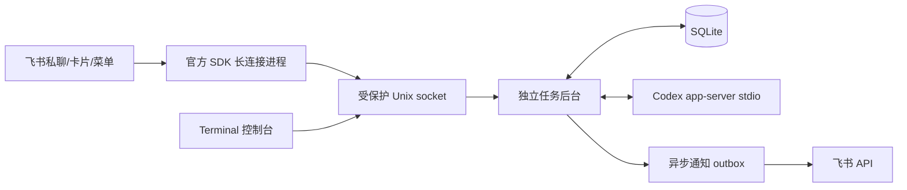

# 飞书 Bot + Codex 任务应用

独立运行在 Ubuntu 用户账户下的开发任务后台。飞书手机端通过按钮创建、选择和继续任务，电脑端通过 `feishu-codex attach` 接管同一后台任务。Python 3.12 + 官方 `lark-oapi` 1.7.3 + asyncio + SQLite + Unix socket；Codex 接口按本机 `codex-cli 0.160.0` 导出的 JSON Schema 实现。

**本机状态（2026-10-11）**：后台已安装为 `zhi` 的 systemd 用户服务；已验证真实 app-server 初始化、创建新目录后运行任务、同一会话继续、进程重启后读取历史并恢复，以及 systemd 服务的实际模型调用。飞书凭据已单独配置，长连接已建立。**用户白名单仍为空；真实消息交互、菜单点击、手机审批须按下面步骤配置后验收。** 测试结果见本文末尾，不把模拟通过等同于飞书端到端通过。

## 1. 文件位置与安装

| 内容 | 本机默认位置 |
| --- | --- |
| 项目源码 | `/home/zhi/ws/feishu-codex` |
| 私有配置 | `~/.config/feishu-codex/config.toml`，权限 `600` |
| SQLite、运行日志、IPC | `~/.local/share/feishu-codex/`，目录权限 `700` |
| 按钮向导的项目目录 | `~/remote-ws/<名字>` |
| 额外允许的工作根目录 | `~/ws` |
| 用户服务 | `~/.config/systemd/user/feishu-codex.service` |
| 命令 | `~/.local/bin/feishu-codex` |

安装或重装：

```bash
cd /home/zhi/ws/feishu-codex
bash scripts/install.sh
export PATH="$HOME/.local/bin:$PATH"
feishu-codex doctor
systemctl --user enable --now feishu-codex
```

安装脚本保留已有配置，不改 `~/.codex/config.toml`、认证文件或模型服务。源码仓库的 [config.example.toml](config.example.toml) 中 App ID、App Secret 和白名单均为空。不要将私有配置复制回源码仓库。Git 已初始化，只管理项目文件，不自动推送。

Python 虚拟环境位于 `.venv/`。在新机器上先安装 Python 3.12、`python3-venv` 和可用的 Codex CLI。`codex_command` 只接受 `[可执行文件, "app-server", "--stdio"]`，不接受绕过沙箱的额外参数。模板中的 Codex 路径由安装脚本适配当前用户。

配置文件可通过 `--config /绝对路径/config.toml` 或 `FEISHU_CODEX_CONFIG` 指定。修改 `data_dir`、`socket_path`、`work_roots` 即可分离部署位置；自定义 socket 的父目录必须由当前用户拥有、权限为 `700`。使用自定义配置部署时：

```bash
FEISHU_CODEX_CONFIG=/你的私有路径/config.toml .venv/bin/python scripts/render-service.py
systemctl --user daemon-reload
systemctl --user restart feishu-codex
```

配置未填写飞书凭据时，本地后台、控制台和全部模拟测试仍可用；`doctor` 明确显示“飞书未配置”。凭据完整不代表白名单已授权，也不代表事件订阅已生效。

## 2. 飞书后台配置与授权

你已启用机器人能力，接着按以下顺序设置。无需公网 IP、域名、Webhook 或入站端口；SDK 从 Ubuntu 主动建立长连接，发消息调用飞书 API。企业管理员可能需要审批权限和发布。

### 2.1 凭据与权限

进入[飞书开发者后台](https://open.feishu.cn/app)，选择企业自建应用。在 **凭证与基础信息** 获取 App ID 和 App Secret，对应配置的 `[feishu].app_id`、`app_secret`。本机已保存你提供的值，不需要再次填写，也不要在聊天任务中粘贴凭据。

在 **权限管理 → 开通权限** 申请以下应用身份权限：

| 权限标识 | 用途 |
| --- | --- |
| `im:message.p2p_msg:readonly` | 读取用户发给机器人的单聊消息 |
| `im:message:send_as_bot` | 以应用身份发送文本、向导和授权卡片，并更新应用发送的卡片 |

本应用初版不需要群消息、通讯录全量读取、云文档、管理员或 CardKit 流式卡片权限。使用 `open_id` 校验身份，不要求获取员工 `user_id`。发送和更新卡片所需权限以飞书当前 API 页面展示为准：[接收消息](https://open.feishu.cn/document/server-docs/im-v1/message/events/receive)、[发送消息](https://open.feishu.cn/document/server-docs/im-v1/message/create)、[更新已发送的消息卡片](https://open.feishu.cn/document/uAjLw4CM/ukTMukTMukTM/reference/im-v1/message/patch)。

### 2.2 长连接、事件与新版卡片回调

先保证本机后台在运行：

```bash
systemctl --user start feishu-codex
feishu-codex doctor
```

进入应用的 **事件与回调**：

1. 在事件配置的订阅方式中选择 **使用长连接接收事件**，保存。保持本机进程运行，平台需要检测到连接。
2. 添加 **接收消息 v2.0**，事件名 `im.message.receive_v1`。
3. 如需底部自定义菜单，再添加 **机器人自定义菜单事件**，事件名 `application.bot.menu_v6`。
4. 在回调配置中同样选择 **使用长连接接收回调**，添加新版 **卡片回传交互** `card.action.trigger`。不要选旧版卡片回调，不要填写公网回调 URL。

代码已注册这三种处理器。当前 SDK 1.7.3 的 CARD 帧丢弃分支由 `CardCompatibleClient` 做局部适配；SDK 仍负责连接、心跳、重连、分片和事件反序列化。测试包含真实 SDK 的 EVENT/CARD protobuf 帧、分片及回调应答。升级 SDK 时先运行相应回归测试。参考[官方 Python 回调说明](https://open.feishu.cn/document/server-side-sdk/python--sdk/handle-callbacks)及[飞书回调长连接说明](https://feishu.apifox.cn/doc-7518584)。

### 2.3 可用范围与发布

在应用的 **版本管理与发布** 创建版本，填写说明，将**应用可用范围**包含你本人及将要使用的成员，提交发布并完成企业审批。应用的权限、事件、回调和自定义菜单有变更时，按后台要求重新发布。若机器人搜索不到或不能对话，先检查发布状态、可用范围以及是否被管理员禁用。测试应用只能覆盖其测试成员。

### 2.4 将本人加入本机白名单

飞书应用权限决定机器人能调用什么 API；**本机白名单决定谁能操作你的电脑**。两者都需要完成。

首次授权推荐流程：

1. 完成上述发布后，在飞书中找到机器人，打开**私聊**，发送 `/whoami`。
2. 在电脑上执行：

   ```bash
   feishu-codex identities
   ```

3. 核对发送时间，找到自己的 `ou_...`。此发现流程仅记录主动发送 `/whoami` 的 open_id 和时间，**不自动授权、不执行任务、不向未知用户发送消息**。若有多个记录，使用飞书 API 调试台中的用户 ID 查询工具确认本人身份；不要把全部记录直接加入白名单。open_id 与应用关联，不能复用另一应用的 ID，参见[官方用户身份说明](https://open.feishu.cn/document/platform-overveiw/basic-concepts/user-identity-introduction/introduction)。
4. 编辑私有配置：

   ```bash
   nano ~/.config/feishu-codex/config.toml
   ```

   只将白名单改为：

   ```toml
   allowed_users = ["ou_你的实际open_id"]
   ```

5. 加载配置：

   ```bash
   chmod 600 ~/.config/feishu-codex/config.toml
   systemctl --user restart feishu-codex
   feishu-codex doctor
   ```

重启会中断当时正在执行的 turn，首次授权时请在创建任务前完成。白名单为空时拒绝全部远程任务、查询和审批；本机同一 Linux 用户的控制台仍可管理任务。飞书用户只可访问本人创建的任务，本地控制台可接管任意本机任务。

## 3. 四个按钮与逐步操作

### 3.1 聊天里的按钮（无需手工创建卡片）

白名单配置好后，给机器人发送 **`菜单`**。应用会发送带有以下按钮的控制卡片，代码自动生成，不需要飞书卡片模板 ID：

| 按钮 | 操作 |
| --- | --- |
| 创建任务 | 第一步列出 `~/remote-ws/` 下已有目录；点击选择，或发送一个新名字。第二步发送自然语言任务描述，立即创建并排队执行 |
| 输入命令 | 显示当前任务和目录，等待你发送后续要求；运行中进入 `turn/steer`，空闲时在同一会话开启后续 turn |
| 任务列表 | 分页显示本人所有任务的编号、状态和描述标签；点击“选择此任务”明确切换上下文 |
| 结束任务 | 显示具体任务和目录，确认后中断任务并使未处理审批失效；保留文件和历史 |
| 查询结果 | 查询当前所选任务、结果摘要、待处理请求和通知失败信息 |

“输入命令”是交给 Codex 的自然语言要求，可以包含开发命令意图，仍由 Codex 按沙箱和审批执行。按钮**不会在操作系统中直接执行你输入的 shell 字符串**。没有选中的任务时，要求先创建或选择；不使用全局最后一次会话。

目录向导只需输入 `weather-demo` 这样的单个名字，即 `~/remote-ws/weather-demo`；新名字自动创建，已有名字复用。目录列表分页，不显示越界符号链接。需要自定义完整路径、历史会话 ID 或幂等键时，可使用后面的命令模式。向导状态和明确选中的任务会持久化；输入步骤有效期为 30 分钟，旧目录卡片和旧结束确认不能误作用于新上下文。发送 **`取消向导`** 只退出输入步骤，不取消任务。完整命令可用 `/` 开头以跳出输入步骤。

### 3.2 飞书底部固定菜单（需要在开发者后台配置）

在 **应用能力 → 机器人 → 机器人自定义菜单** 中编辑。可创建一个名为 **任务** 的父菜单，在其下添加四个子菜单；动作类型选 **推送事件/事件**，配置如下：

| 菜单文字 | 事件 Key（必须完全一致） |
| --- | --- |
| 创建任务 | `create_task` |
| 输入命令 | `input_command` |
| 任务列表 | `list_tasks` |
| 结束任务 | `end_task` |

保存菜单，确认已订阅 `application.bot.menu_v6`，然后**创建新版本并发布**。重新进入机器人私聊即可点击。首次菜单事件不带 chat_id，应用通过操作者 open_id 发送第一张向导卡；后续消息/卡片回调绑定实际私聊。参考[官方机器人菜单事件](https://open.feishu.cn/document/uAjLw4CM/ukTMukTMukTM/application-v6/bot/events/menu)。后台页面文字可能随飞书版本调整，以事件名和 Key 为准。

如果暂不配置底部菜单，发送“菜单”得到的卡片按钮已具备相同功能。本项目不代替你修改飞书开发者后台菜单或发布应用。

### 3.3 审批卡片与普通问题

当 app-server **真实发起**授权请求时，后台主动发送单独的授权卡片，展示任务、请求编号、实际操作、工作目录、原因和权限范围。飞书呈现为聊天中的交互卡片；不创建浏览器标签页，也不需要外部授权网站。只展示该协议请求允许的决定：批准本次、拒绝、拒绝并中断。

权限申请类请求按协议可授权到当前 turn，卡片明确标为“批准当前 turn 权限”。不提供批准整个会话、永久规则和自动批准。显式要求会话级目录权限的 `grantRoot` 请求，本版本仅允许拒绝/取消，需缩小范围后重试。超出飞书卡片容量的操作不展示批准按钮，转 Terminal 查看完整内容。策略直接拒绝的操作会在进展/失败状态中显示；客户端不能把策略禁止变成可批准。

一条审批只有一份数据库记录。任务、用户、私聊、请求编号、进程代次、活动 turn、超时和允许选项都要匹配；重复、取消、过期、服务端已解决及重启前的请求不能再次批准，卡片异步更新为处理结果。

普通用户输入请求会标注 **“回答问题（非操作授权）”**，卡片列出问题 ID 和回答格式：

```text
answer 任务编号 问题请求编号 {"问题ID":["你的回答"]}
```

所有问题 ID 必须完整提供，答案不作为批准决定。敏感回答请在本机 `attach` 界面输入，避免留在飞书历史或 shell 命令历史中。未支持的 app-server 交互请求返回明确错误并中断对应 turn，不会悄悄卡住。

## 4. 手机创建 → 审批 → Terminal 接管 → 查询结果

1. 飞书私聊发送“菜单”，点击 **创建任务**。
2. 在目录步骤发送 `weather-demo`；应用将使用 `/home/zhi/remote-ws/weather-demo`。也可以点击列表中的已有目录。
3. 在描述步骤发送：

   ```text
创建一个 Python 命令行天气演示程序。先用内置示例数据，不依赖真实 API。
实现参数解析、单元测试和 README，在当前任务目录初始化 Git 并提交项目文件，不推送。
如果需要执行被沙箱限制的操作，请提出审批。不要生成独立任务报告。
   ```

4. 记下返回的真实任务编号，例如 `a1b2c3d4e5f6`（下文为占位示例）。若收到授权卡片，检查实际操作后点 **批准本次** 或 **拒绝**。并非所有任务都需要审批；没有请求时不会伪造卡片。希望更频繁人工检查，可在创建任务前将配置改为 `approval_policy = "untrusted"` 并重启。
5. 到电脑前运行：

   ```bash
   feishu-codex tasks
   feishu-codex attach a1b2c3d4e5f6
   ```

6. 终端显示历史和后续进展。在界面中可输入：

   ```text
   /append 增加 JSON 输出选项，并补对应测试
   /status
   /decide 此处填写真实请求编号 accept
   /answer 此处填写真实问题请求编号 {"问题ID":["你的回答"]}
   /detach
   ```

7. `/detach` 或 **Ctrl+C** 只退出界面并释放控制权，后台继续运行。此任务在接管期间暂停飞书主动通知，其他任务不受影响；飞书仍可查询。飞书对该任务的修改和审批会明确返回 Terminal 控制中。释放或断线后恢复通知，未解决审批按原记录补发/更新，积压进度会合并。
8. 在手机上点击 **任务列表 → 选择此任务 → 查询结果**，或在电脑执行：

   ```bash
   feishu-codex status a1b2c3d4e5f6
   ```

`/interrupt` 只中断当前 turn，之后可明确继续；`/cancel` 或“结束任务”的确认按钮取消整条任务。完成的任务仍可追加要求，已取消的任务需重新创建。**结束任务与退出终端是不同操作。**

## 5. 命令模式

机器人私聊及本地命令使用相同语义。本地调用在命令前加 `feishu-codex`：

```text
create --workdir ~/remote-ws/demo --mkdir --key phone-demo-1 -- 实现一个程序并补测试
create --workdir demo --mkdir --thread 历史会话ID -- 先检查历史与当前文件，再按这些新要求继续
tasks
status 任务编号
append 任务编号 增加日志和测试
continue 任务编号 检查上次中断后的目录状态，只完成尚未完成的部分
interrupt 任务编号
cancel 任务编号
decide 任务编号 请求编号 decline
answer 任务编号 请求编号 {"q1":["答案"]}
diagnose
help
```

在 shell 中建议将目录的 `~` 路径和正文引用，例如：

```bash
feishu-codex create --workdir '~/remote-ws/demo' --mkdir --key demo-1 -- '实现 hello.py，补 README 和测试，不推送'
```

工作路径正确展开 Home，规范化后检查配置根目录和符号链接目标；相对路径位于 `work_roots` 第一项。不存在的目录必须显式 `--mkdir`（按钮向导输入名字即表示创建）；无效路径报错，不回退到其他目录。历史会话的实际 cwd 必须与目标相同，已有任务绑定的会话不能再绑定第二个任务。

`--key` 在用户范围内幂等；相同 Key、相同内容返回原任务，不同内容报错。消息依据 `message_id` 去重，卡片/菜单事件另行去重。命令正文允许多行自然语言。明确选择的飞书向导上下文仅属于该用户的私聊；命令模式始终要求具体任务编号。

## 6. 后台、恢复与通知语义



后台独占 app-server 的 stdin/stdout，默认全局串行执行。查询不需要获得修改锁，等待审批不阻塞状态查询。飞书长连接在单独子进程运行，SDK 断线自动重连；进程退出由后台限速重启。终端通过同一 UID 的 Unix socket 接入，socket 为 `600`，有连接级控制租约和心跳；终端不运行另一个 Codex，也不用 `codex resume` 假装附着。

SQLite 持久化任务、thread/turn、关键操作与完成消息、审批元数据、事件去重、向导上下文和通知状态。不保存原始逐 token 输出/内部推理，不生成 Markdown 任务报告或 `reports/`。实际任务产出的 README 等项目文件位于任务目录。

进程重启：尚未提交的 `queued` 任务可以排队启动；`starting/running/waiting/cancelling` 任务标为 `interrupted`，原审批失效。用户明确发出继续要求后，读取真实历史并 `thread/resume`，随后只提交新要求。无法读取/恢复历史时明确显示错误。RPC 超时不自动重放任务、追加指令或决定，因为此前的操作可能已产生副作用。恢复会话不等于恢复原进程的审批或仍在运行的 turn。

通知在独立 outbox 发送，使用稳定 UUID、去重、有限重试及状态记录。失败不会终止任务，可在 `status` 或“查询结果”查看。审批卡片处理后优先更新原消息；终端接管期间暂停该任务尚未发出的主动通知，已经提交给飞书 API 的在途消息无法撤回。显式查询和向导交互仍可回复。HTTP 响应丢失等极端情况受飞书服务端 UUID 去重期限约束，不宣称跨任意长故障的绝对一次送达。

运行日志 `daemon.log` 默认每份 2 MiB、保留 3 份归档。配置可调整 RPC、turn、审批、租约、进度节流和通知重试；默认 turn 2 小时、审批 30 分钟、租约 30 秒、进度 30 秒。中断请求在 15 秒内未收到 turn 完成事件，会终止所属 app-server 并明确标记状态，避免永远卡在取消中。日志只记录事件类型和连接状态；原始 app-server stderr 和 SDK 网络日志不落盘，以免泄露凭据。显示和数据库写入会替换已知凭据及常见凭据格式，但不要把新的未知密钥写入任务文本。

同一机器用户拥有目录和 socket；这不是隔离恶意同 UID 程序的多租户系统。任务目录授权与 Codex 的沙箱共同生效，不能代替操作系统文件权限；不要让另一个 Codex/编辑器同时自动改动同一项目。

## 7. 运维命令

```bash
systemctl --user start feishu-codex
systemctl --user stop feishu-codex
systemctl --user restart feishu-codex
systemctl --user enable feishu-codex
systemctl --user disable feishu-codex
systemctl --user status feishu-codex --no-pager
journalctl --user -u feishu-codex -n 100 --no-pager
tail -f ~/.local/share/feishu-codex/daemon.log
feishu-codex doctor
feishu-codex diagnose
```

后台以当前用户运行，使用该用户的 Home、Codex 配置和认证。systemd 不加载交互式 shell 的 `.zshrc`；若模型服务依赖 shell 中专门导出的变量，请通过受保护的 systemd `EnvironmentFile` 或用户服务环境提供原有变量，不把 API Key 写入 unit 或仓库。当前机器已通过服务内真实模型任务验证，不需要切换认证。

退出登录后持续运行需启用用户 lingering：

```bash
loginctl show-user "$USER" -p Linger
# 若不是 yes，由管理员执行：
sudo loginctl enable-linger "$USER"
```

本机已检查为 `Linger=yes`。睡眠/关机期间不会继续计算或接收消息；恢复后可重连，崩溃中的 turn 按中断语义处理。

备份应先停止服务，再备份私有配置、数据目录和需要的项目目录；若要恢复 Codex 历史，还需保留原用户的 Codex 会话存储。不要仅复制 SQLite 而丢失它引用的 Codex 会话。不要公开备份，其中含任务内容和凭据。

常见排查：

| 现象 | 检查 |
| --- | --- |
| 飞书显示已连接但机器人无回复 | 权限、消息订阅、应用发布、可用范围、白名单；先发送 `/whoami` 再本机查 identities |
| 菜单点击无反应 | `application.bot.menu_v6`、四个 event_key、发布后的菜单版本 |
| 文字可用但卡片按钮无响应 | 新版 `card.action.trigger` 回调是否选了长连接；检查是否装了锁定 SDK 版本 |
| 权限拒绝 | 用户是否在白名单、任务是否属于本人、Terminal 是否接管、审批是否过期 |
| app-server disconnected | Codex 路径、原有模型服务配置、配置文件权限、网络和服务日志 |
| interrupted | 先检查任务目录和已有结果，再用明确的新要求继续，不盲目重放原任务 |
| 通知 failed | 查看 `status` 的 numeric API code、飞书权限和可用范围；不影响任务本身 |
| 终端连接失败 | 服务是否运行、两端是否使用同一个 `--config` 和 socket、是否为同一 Linux UID |

## 8. 测试与验收

```bash
cd /home/zhi/ws/feishu-codex
bash scripts/test.sh
bash scripts/check-protocol.sh
.venv/bin/ruff check src tests scripts
```

本机模拟与协议回归结果：**40 passed**，静态检查通过。模拟测试不读取真实飞书配置、不发真实消息、不调用模型。覆盖新目录与符号链接边界、串行执行、继续/steer/取消、批准/拒绝/重复/过期/错误归属、普通用户输入、幂等和去重、SQLite 恢复、真实 Unix socket 断开、后台进程被杀后恢复、终端接管与通知暂停恢复、通知失败与积压隔离、凭据脱敏、真实 SDK 消息/卡片/菜单帧和请求构造、按钮向导/上下文/旧卡片失效。SDK 内置 protobuf 有两条 Python 弃用警告，不影响通过。

`scripts/audit-secrets.py` 会以不输出凭据值的方式检查 Git 跟踪文件及本应用日志/数据库中是否存在本机已知凭据。本机检查未发现已知凭据进入上述内容；私有配置与运行数据均不在 Git 中。

真实 Codex 测试需主动运行，会调用现有模型服务，创建临时项目，**不自动批准**任何请求：

```bash
.venv/bin/python scripts/live-smoke.py
# 验证已安装服务的模型配置；服务须已运行：
.venv/bin/python scripts/live-service-smoke.py
```

已实际完成：初始化、`thread/start` 指定不存在目录创建后的 cwd、`turn/start` 创建 hello.py/README 并运行得到 42、同 thread 后续 turn、重启后 `thread/read` + `thread/resume`、systemd 服务通过 IPC 执行模型任务。临时项目在测试结束后删除；持久服务的本地测试任务记录会保留，目录已删除的测试记录不能继续执行。

**配置后待验收**：本人加入白名单；手机“菜单”卡片和底部四个菜单；实际飞书目录选择及任务描述；手机真实审批/拒绝与卡片更新；飞书普通输入；手机与 Terminal 切换；真实通知和限流失败恢复。长连接握手成功仅证明连接，不代表上述交互已验收。本机未发送未经请求的试探消息。

官方 Codex 文档：[App Server](https://developers.openai.com/codex/app-server)。协议可能随 Codex 更新改变，升级后先导出 schema 并运行协议/进程/SDK 测试，再执行真实最小任务；不要直接修改字段猜测兼容。
